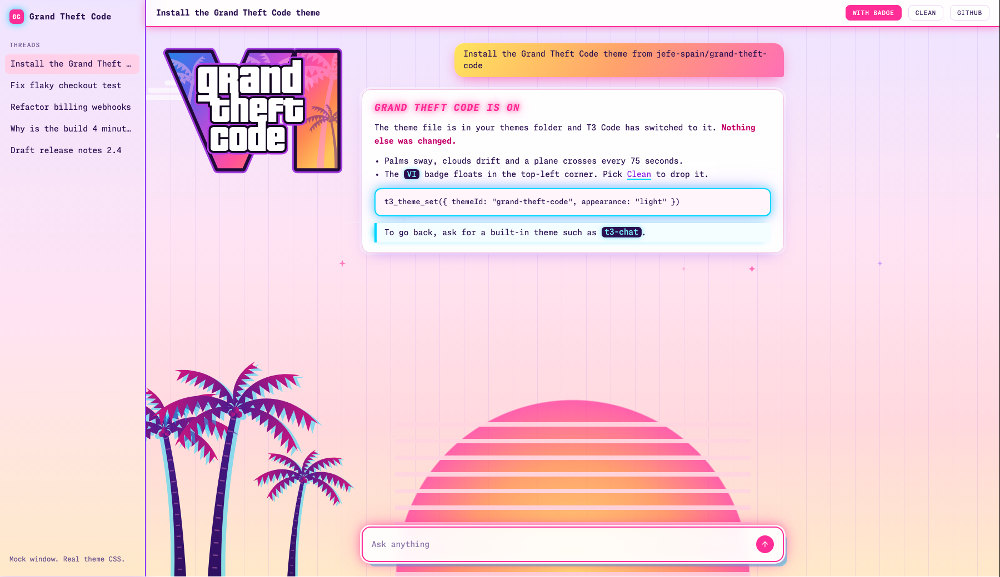
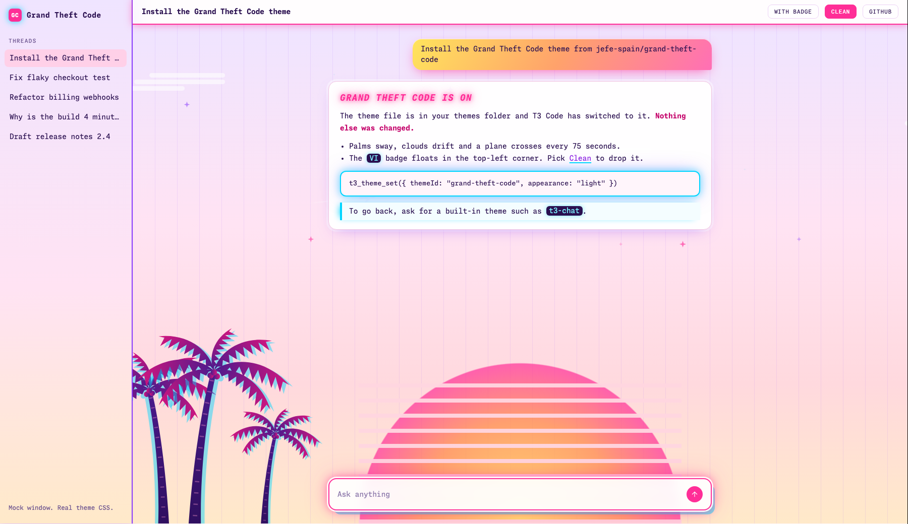

# Grand Theft Code

Un tema animado de atardecer para [T3 Code](https://t3.codes). Las palmeras se mecen, las nubes pasan, un avión cruza el cielo y un logo VI flota en la esquina.

**[Demo en vivo](https://jefe-spain.github.io/grand-theft-code/)** · [Read in English](README.md)



La imagen es la [página de demo](docs/index.html): una ventana de chat simulada con el CSS real del tema. No es una captura de T3 Code.

## Instalación

Pega esto en un hilo de T3 Code:

```text
Instala el tema Grand Theft Code para T3 Code. Sigue los pasos de
https://raw.githubusercontent.com/jefe-spain/grand-theft-code/main/INSTALL.md
```

Tu agente descarga un fichero JSON en la carpeta de temas de T3 Code, lo comprueba y cambia a ese tema. [INSTALL.md](INSTALL.md) tiene todos los pasos, así puedes leer antes lo que va a hacer.

Si quieres la versión sin logo, añade «usa la variante clean» al mensaje.

### A mano

1. Descarga [`themes/grand-theft-code.json`](themes/grand-theft-code.json) en la carpeta de temas de T3 Code. En macOS es `~/.t3/userdata/themes/`.
2. Pide a tu agente: «cambia T3 Code al tema grand-theft-code en modo claro».

Probado con T3 Code 0.1.10 en macOS. Los temas se aplican en las apps de escritorio y web, no en la móvil.

## Variantes

| Id del tema | Fichero | Qué incluye |
| --- | --- | --- |
| `grand-theft-code` | [`themes/grand-theft-code.json`](themes/grand-theft-code.json) | Todo, incluido el logo VI |
| `grand-theft-code-clean` | [`themes/grand-theft-code-clean.json`](themes/grand-theft-code-clean.json) | El mismo tema sin el logo |



## Qué trae

- **Escena de fondo:** un único SVG animado. Tres palmeras con las copas en movimiento, nubes, estrellas que parpadean, un avión cada 75 segundos y una estrella fugaz cada 24.
- **Cielo:** un sol a rayas y un degradado de lila a melocotón, dibujados como capas CSS bajo la escena.
- **Logo:** un VI con degradado de azul a amarillo y palmeras dentro. Flota, y un brillo lo cruza cada 7 segundos.
- **Chat:** tarjetas blancas con resplandor violeta, degradado de atardecer en tus mensajes, títulos de neón y bloques de código en cian.
- **Interfaz:** barra lateral, cabecera, menús, barras de desplazamiento y colores del terminal a juego.
- **Movimiento reducido:** todas las animaciones se paran si tu sistema pide menos movimiento.

El tema usa [Monaspace Neon](https://monaspace.githubnext.com/) si la tienes instalada y la fuente monoespaciada del sistema si no.

## Volver atrás

Pide a tu agente un tema de serie, por ejemplo «cambia T3 Code al tema t3-chat». Para quitar Grand Theft Code del todo, borra después su fichero JSON de la carpeta de temas.

## Modificarlo

Los ficheros de `themes/` se generan. Edita las fuentes y vuelve a construir:

```sh
python3 build.py           # escribe themes/*.json y docs/index.html
python3 build.py --check   # lo que ejecuta el CI: falla si lo generado está desfasado
```

Solo necesita Python 3.9 o superior.

| Ruta | Qué contiene |
| --- | --- |
| [`src/theme.json`](src/theme.json) | Nombre, apariencia y roles de color |
| [`src/theme.css`](src/theme.css) | Reglas de la interfaz, solo con los selectores estables de T3 Code |
| [`src/scene.svg`](src/scene.svg) | El fondo animado. Ábrelo en un navegador para verlo solo |
| [`src/demo.html`](src/demo.html) | La ventana de chat simulada de la demo |
| [`build.py`](build.py) | Une las fuentes en los ficheros del tema y comprueba los límites de T3 Code |
| [`tools/wordmark.py`](tools/wordmark.py) | Convierte texto en el rótulo trazado del logo |
| [`tools/screenshots.sh`](tools/screenshots.sh) | Genera las imágenes de `assets/` |

T3 Code admite 50.000 caracteres de CSS por tema y ningún fichero externo; por eso la escena viaja dentro del CSS como data URI. El build falla si un cambio incumple alguna de las dos reglas.

Para probar un cambio, ejecuta el build, abre `docs/index.html` y pide a tu agente que aplique `themes/grand-theft-code.json` desde tu copia.

## Créditos y aviso legal

- Grand Theft Code es un homenaje hecho por fans. No está afiliado, avalado ni patrocinado por Rockstar Games ni Take-Two Interactive. Grand Theft Auto es una marca suya. El logo se dibujó para este proyecto y no contiene material del juego.
- El rótulo del logo está compuesto en [Pricedown Black](https://typodermicfonts.com/pricedown/) de Typodermic Fonts y se incluye como dibujo trazado bajo su licencia de escritorio. La fuente no está en este repositorio.
- Este proyecto no está afiliado a T3 Code ni a sus creadores.
- El código y los dibujos se publican bajo la [licencia MIT](LICENSE).
