<h1 align="center">Grand Theft Code</h1>

<p align="center">
  An animated sunset theme for <a href="https://t3.codes">T3 Code</a>. Your agent installs it from one message.
</p>

<p align="center">
  <a href="https://github.com/jefe-spain/grand-theft-code/actions/workflows/check.yml"></a>
  <a href="https://github.com/jefe-spain/grand-theft-code/stargazers"></a>
  <a href="LICENSE"></a>
</p>

<p align="center">
  <a href="https://jefe-spain.github.io/grand-theft-code/"><b>Live demo</b></a> · <a href="README.es.md">Español</a>
</p>

<p align="center">
  
</p>

<p align="center"><sub>Animated mock-up. The threads and messages in it are invented.</sub></p>

## Install

Paste this into a T3 Code thread:

```text
Install the Grand Theft Code theme for T3 Code:

1. Call t3_theme_read and take themesDir from the result.
2. Download https://raw.githubusercontent.com/jefe-spain/grand-theft-code/main/themes/grand-theft-code.json into that folder, keeping the file name.
3. Call t3_theme_set with themeId "grand-theft-code" and appearance "light".
```

To go back, ask your agent for a built-in theme such as `t3-chat`.

<details>
<summary>Without the VI badge</summary>
<br>

Use `grand-theft-code-clean` instead of `grand-theft-code`, both in the URL and in the theme id.


</details>

<details>
<summary>Manual install</summary>
<br>

Download [`themes/grand-theft-code.json`](themes/grand-theft-code.json) into T3 Code's themes folder (`~/.t3/userdata/themes/` on macOS), then ask your agent to switch to the `grand-theft-code` theme.
</details>

## Features

- **Animated background** in a single SVG: swaying palms, drifting clouds, a plane, a shooting star and a floating VI badge.
- **The whole app restyled:** chat, composer, sidebar, popups, scrollbars and terminal colors.
- **Reduced motion respected:** every animation stops when your system asks for it.
- **[Monaspace Neon](https://monaspace.githubnext.com/)** when it is installed, the system monospace font otherwise.

Tested with T3 Code 0.1.10 on macOS. Themes apply to the desktop and web apps, not to mobile.

## Development

The theme files are built from the sources in `src/`. Python 3.9 or newer, no dependencies.

```sh
python3 build.py          # src/ -> themes/ and the demo page
python3 tools/mockup.py   # the animated preview above
```

## Credits

A fan-made homage, not affiliated with Rockstar Games, Take-Two Interactive or T3 Code. Grand Theft Auto is a trademark of its owners. The badge was drawn for this project and contains no game assets; its lettering is [Pricedown](https://typodermicfonts.com/pricedown/) by Typodermic Fonts, included as outlines.

Released under the [MIT License](LICENSE).
