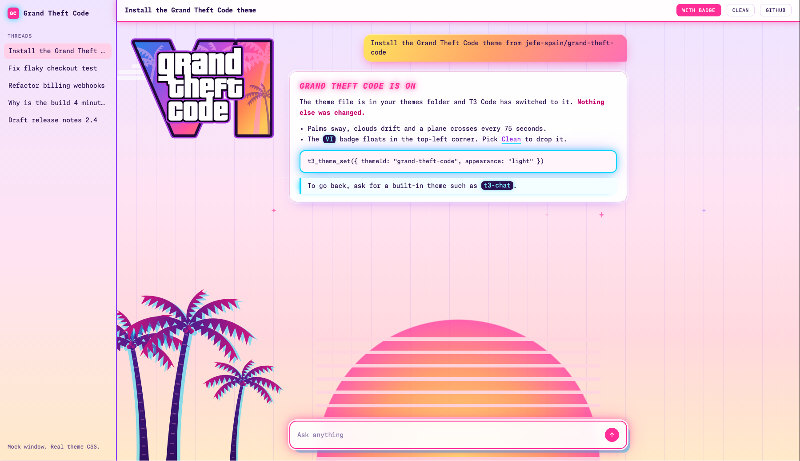
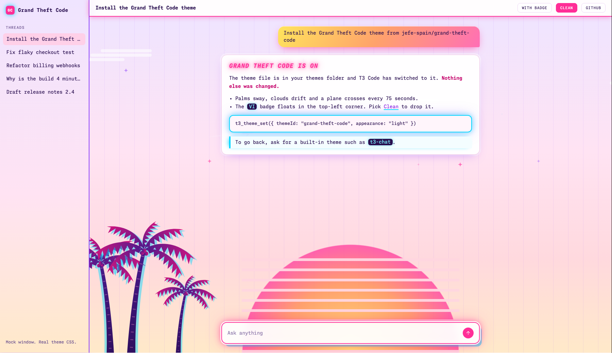

# Grand Theft Code

An animated sunset theme for [T3 Code](https://t3.codes). Palms sway, clouds drift, a plane crosses the sky, and a VI badge floats in the corner.

**[Live demo](https://jefe-spain.github.io/grand-theft-code/)** · [Leer en español](README.es.md)



The picture is the [demo page](docs/index.html): a mock chat window styled by the real theme CSS. It is not a capture of T3 Code itself.

## Install

Paste this into a T3 Code thread:

```text
Install the Grand Theft Code theme for T3 Code. Follow the steps in
https://raw.githubusercontent.com/jefe-spain/grand-theft-code/main/INSTALL.md
```

Your agent downloads one JSON file into T3 Code's themes folder, checks it, and switches to it. [INSTALL.md](INSTALL.md) is the full list of steps, so you can read what it will do first.

For the version without the badge, add "use the clean variant" to the prompt.

### By hand

1. Download [`themes/grand-theft-code.json`](themes/grand-theft-code.json) into T3 Code's themes folder. On macOS that is `~/.t3/userdata/themes/`.
2. Ask your agent to "switch T3 Code to the grand-theft-code theme in light mode".

Tested with T3 Code 0.1.10 on macOS. Themes apply to the desktop and web apps, not to mobile.

## Variants

| Theme id | File | What you get |
| --- | --- | --- |
| `grand-theft-code` | [`themes/grand-theft-code.json`](themes/grand-theft-code.json) | Everything, including the VI badge |
| `grand-theft-code-clean` | [`themes/grand-theft-code-clean.json`](themes/grand-theft-code-clean.json) | The same theme without the badge |



## What is in it

- **Background scene:** one animated SVG. Three palms with swaying crowns, drifting clouds, twinkling stars, a plane every 75 seconds and a shooting star every 24.
- **Sky:** a striped sun and a lilac-to-peach gradient, drawn as CSS layers under the scene.
- **Badge:** a VI in a blue-to-yellow gradient with palms inside. It floats, and a shine crosses it every 7 seconds.
- **Chat:** white message cards with a violet glow, a sunset gradient on your own messages, neon headings and cyan code blocks.
- **Chrome:** matching sidebar, header, popups, scrollbars and terminal colors.
- **Reduced motion:** every animation stops when your system asks for less motion.

The theme uses [Monaspace Neon](https://monaspace.githubnext.com/) if you have it and the system monospace font if you do not.

## Going back

Ask your agent for a built-in theme, such as "switch T3 Code to the t3-chat theme". To remove Grand Theft Code completely, delete its JSON file from the themes folder afterwards.

## Change it

The files in `themes/` are generated. Edit the sources and rebuild:

```sh
python3 build.py           # writes themes/*.json and docs/index.html
python3 build.py --check   # what CI runs: fails if the built files are stale
```

It needs Python 3.9 or newer and nothing else.

| Path | What it holds |
| --- | --- |
| [`src/theme.json`](src/theme.json) | Name, appearance and color roles |
| [`src/theme.css`](src/theme.css) | Interface rules, using only T3 Code's stable selectors |
| [`src/scene.svg`](src/scene.svg) | The animated background. Open it in a browser to see it alone |
| [`src/demo.html`](src/demo.html) | The mock chat window behind the live demo |
| [`build.py`](build.py) | Joins the sources into the theme files and checks T3 Code's limits |
| [`tools/wordmark.py`](tools/wordmark.py) | Turns text into the outlined lettering on the badge |
| [`tools/screenshots.sh`](tools/screenshots.sh) | Renders the pictures in `assets/` |

T3 Code allows 50,000 characters of theme CSS and no external files, which is why the scene travels inside the CSS as a data URI. The build fails if a change breaks either rule.

To try a change, run the build, open `docs/index.html`, then ask your agent to apply `themes/grand-theft-code.json` from your checkout.

## Credits and legal

- Grand Theft Code is a fan-made homage. It is not affiliated with, endorsed by or sponsored by Rockstar Games or Take-Two Interactive. Grand Theft Auto is their trademark. The badge was drawn for this project and contains no game assets.
- The badge lettering is set in [Pricedown Black](https://typodermicfonts.com/pricedown/) by Typodermic Fonts and included as outlined artwork under Typodermic's desktop licence. The font itself is not in this repository.
- This project is not affiliated with T3 Code or its makers.
- Code and artwork are released under the [MIT License](LICENSE).
